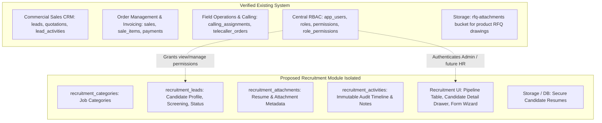
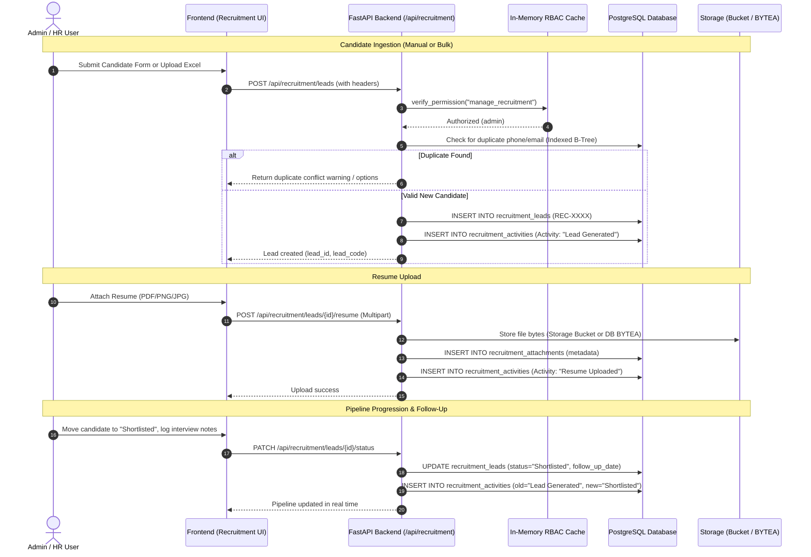
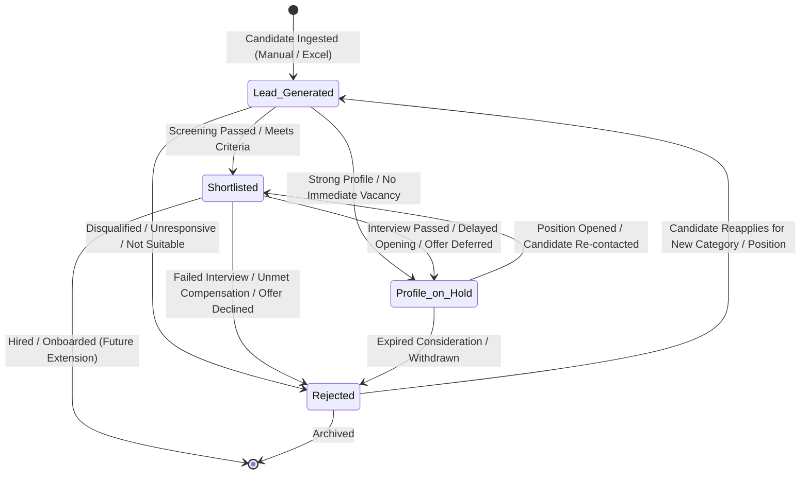
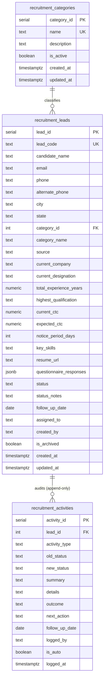
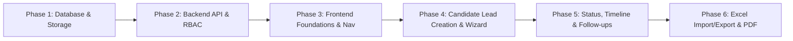

# Recruitment Module — Planning and Technical Design Document
**Parul Chemicals Sales Management Application**  
**Document Version:** 1.0.0  
**Status:** Pending Lead Review & Approval  
**Date:** October 2026  

---

## Table of Contents
1. [Executive Summary](#1-executive-summary)
2. [Existing Codebase & Architecture Context](#2-existing-codebase--architecture-context)
3. [End-to-End Candidate Workflow](#3-end-to-end-candidate-workflow)
4. [Recruitment Pipeline & Status Transitions](#4-recruitment-pipeline--status-transitions)
5. [Database Architecture & Schema Specification](#5-database-architecture--schema-specification)
6. [Resume & Attachment Storage Analysis](#6-resume--attachment-storage-analysis)
7. [Required Resources & Technical Scope](#7-required-resources--technical-scope)
8. [Risk Assessment & Practical Mitigations](#8-risk-assessment--practical-mitigations)
9. [Phased Implementation Roadmap](#9-phased-implementation-roadmap)
10. [Open Decisions & Clarifications for the Project Lead](#10-open-decisions--clarifications-for-the-project-lead)

---

## 1. Executive Summary

This document presents the complete architectural blueprint and technical plan for developing the new **Recruitment Module** within the existing Parul Chemicals Sales Management System (`pc_sales`).

The Recruitment Module will provide a dedicated platform to manage the candidate talent acquisition pipeline across company departments (sales, field operations, telecalling, plant, administrative, and technical roles). It replaces manual offline tracking and ad-hoc resume storage with an integrated, searchable, and auditable candidate management system.

### Key Architectural Commitments:
- **Zero Impact on Commercial CRM:** Recruitment candidate records are completely isolated from commercial CRM sales leads (`leads` table) to maintain database hygiene and avoid skewing sales forecasting.
- **Strict Role-Based Security:** Initial release is restricted exclusively to the `admin` role via discrete permissions (`view_recruitment` and `manage_recruitment`). The existing `hr_&_administration` role is already present in the database and can be seamlessly granted access later without database or code refactoring.
- **Hardened Row-Level Security (RLS):** Database-level policies ensure that direct Supabase Data API calls from unauthorized client tokens (e.g. telecallers, field staff) receive zero rows. All operational traffic flows through FastAPI.
- **Extensible Questionnaire Framework:** Screening questionnaires are stored as structured `JSONB` documents within candidate records, permitting flexible, role-specific questions without requiring repetitive schema migrations.
- **Explicit Resume Storage Options:** A rigorous comparative evaluation is documented between storing binary files directly in PostgreSQL (`BYTEA`) versus using private Supabase Object Storage with database metadata, pending the project lead's final selection.

---

## 2. Existing Codebase & Architecture Context

### 2.1 Verified Existing Architecture
The existing application uses a modern decoupled architecture:

| Tier | Verified Technology Stack | Current Implementation Patterns |
|---|---|---|
| **Frontend** | React 18, TypeScript, Vite, Material UI (MUI v5) | - SPA with React Router v6 in `App.tsx`<br>- Dynamic dark/light theming via `theme.ts`<br>- Centralized Axios client (`api.ts`) injecting `x-user-email` and `x-user-role`<br>- RBAC context (`AuthContext.tsx`) caching permissions in state |
| **Backend** | Python 3.11+, FastAPI | - Modular routers in `backend/routers/` registered in `main.py`<br>- Pydantic request/response validation in `models.py`<br>- In-memory RBAC permission caching (`_PERMISSION_CACHE` with 10-minute TTL in `rbac_utils.py`)<br>- Persistent HTTP sessions via `supabase_db.py`<br>- ReportLab PDF engine with custom Gujarati Unicode fonts (`NotoSansGujarati`) & openpyxl in `reports.py` |
| **Database** | Supabase PostgreSQL | - Relational tables with `SERIAL` primary keys and UTC timestamps<br>- Custom RBAC tables: `app_users`, `roles`, `permissions`, `role_permissions`<br>- Fast-path role resolution via `roles.permission_keys TEXT[]`<br>- Supabase Storage for RFQ document attachments (`rfq-attachments`) |

### 2.2 Navigation Placement
In [Layout.tsx](file:///d:/Study/Internship/PC_Sales/Website-code/pc_sales/frontend/src/components/Layout.tsx), **Call Distribution** is located at line 858, immediately following `<Divider sx={{ my: 1 }} />` inside the Admin/Management section.

The Recruitment Module navigation item will be placed **immediately before Call Distribution**:
- Positioned inside the management block right after the `<Divider />` and before Call Distribution (line 858).
- Gated by `hasPermission(PERMISSIONS.VIEW_RECRUITMENT)`.
- Route registered in `App.tsx` as `/recruitment`, wrapped in `<ProtectedRoute requiredPermission={PERMISSIONS.VIEW_RECRUITMENT}>`.

### 2.3 Verified Existing vs. Proposed Functionality



---

## 3. End-to-End Candidate Workflow



### Detailed Lifecycle Phases:

#### 1. Ingestion Phase
- **Manual Intake:** Admin fills a multi-step form dialog (`CandidateFormDialog`):
  - **Step 1: Basic Profile:** Full Name, Primary Phone (validated to 10 digits), Email, Alternate Contact, Current Location (City/State), Job Category, Recruitment Source.
  - **Step 2: Professional Background:** Current Employer, Current Role/Designation, Total Experience (Years), Highest Qualification, Current CTC, Expected CTC, Notice Period (Days), Key Skills.
  - **Step 3: Screening Questionnaire:** Category-aligned questionnaire fields (e.g. driving license, vehicle ownership, willingness to travel/relocate, territory knowledge, language proficiencies, interviewer assessment notes).
  - **Step 4: Resume Attachment:** Drag-and-drop or file upload for candidate resume (PDF, PNG, JPG, JPEG; max 10MB) with live validation.
- **Bulk Excel Import:**
  - Standardized Excel template downloadable from UI.
  - Client-side pre-parsing via SheetJS (`xlsx`) to preview imported rows.
  - Server-side pre-validation checking for missing mandatory fields and malformed phone numbers.
  - Pre-import duplicate resolution interface: allows Admin to **Skip**, **Overwrite/Update**, or **Import as New Lead**.
  - Audit logging of bulk imports into `import_history` (matching the existing Sabhasad/Distributor import pattern).

#### 2. Validation & Duplicate Detection Rules
- Primary match key: **Cleaned 10-digit mobile number** (`phone`).
- Secondary match key: **Case-insensitive email address** (`LOWER(TRIM(email))`).
- Matching strategy:
  - If a duplicate phone/email exists, the system does not crash or silently discard data.
  - In manual creation, UI presents an immediate alert linking to the existing candidate record (`"Candidate already exists: REC-0042 (John Doe)"`).
  - Allows intentional re-application (e.g., candidate reapplying for a different category after 6 months) by tracking application source and date.

#### 3. Questionnaire & Information Gathering
- Stored as structured JSON within `recruitment_leads.questionnaire_responses`.
- Divided into logical sections:
  1. *Operational & Logistics:* Vehicle ownership, driving license, relocation willingness, preferred work territory.
  2. *Domain Expertise:* Prior chemical/fertilizer/cattle feed experience, dealer/distributor network relationships, communication proficiency.
  3. *Evaluator Impressions:* Technical rating (1-5), communication rating (1-5), structured interviewer comments.

#### 4. Resume & Document Management
- Supported formats: `.pdf`, `.png`, `.jpg`, `.jpeg`. Max size: 10 MB.
- Direct preview support: Images render inline; PDFs open in an integrated modal viewer or new browser tab.
- Document replacement and removal are audited in `recruitment_activities`.

#### 5. Candidate Review, History & Follow-ups
- Split-screen workspace layout (inspired by [LeadWorkspace.tsx](file:///d:/Study/Internship/PC_Sales/Website-code/pc_sales/frontend/src/pages/LeadWorkspace.tsx)):
  - Left pane: Filterable, searchable candidate master list with status badges, category chips, and follow-up indicators.
  - Right pane: Rich candidate dossier displaying personal details, questionnaire answers, resume preview, and complete chronological activity timeline.
- Follow-up scheduling: Allows setting an optional `follow_up_date` (e.g. for interview callbacks, document verification, or re-contacting candidates on hold).
- Top dashboard cards display upcoming follow-ups due today or overdue.

#### 6. Search, Filter, Export & Archival
- Filter by: Status, Category, Experience Range, Notice Period, Sourced Date, Follow-up Due.
- Free-text search across Candidate Name, Phone, Email, Company, Designation, and Key Skills.
- Export to Excel (`openpyxl` via `reports.py`) with Parul Chemicals branding, KPI block, and filter metadata.
- Export to PDF (`ReportLab`) generating formatted single-candidate profile sheets or candidate summary lists.
- Archival: Rejected or obsolete profiles can be archived (`is_archived = TRUE`) to keep active views clean while retaining full data for future talent pool queries.

---

## 4. Recruitment Pipeline & Status Transitions

The candidate recruitment lifecycle is governed by **4 standardized statuses**.



### Detailed Status Definitions & Rules

| Status | Business Meaning | Permitted Next Transitions | Required Data on Transition | Audit Action |
|---|---|---|---|---|
| **Lead Generated** | Initial candidate record created; screening not yet completed. | `Shortlisted`, `Profile on Hold`, `Rejected` | Source, initial resume (if available), category. | Automated activity: `"Candidate lead generated via [Source]"`. |
| **Shortlisted** | Candidate passed initial screening; qualified for interviews or technical evaluation. | `Profile on Hold`, `Rejected`, *(Hired in future)* | Evaluation notes, optional `follow_up_date` (interview date/time). | Activity log with evaluator notes and scheduled interview date. |
| **Profile on Hold** | Qualified candidate kept in active talent pool (e.g., vacancy postponed, candidate serving long notice, or deferred hiring). | `Shortlisted`, `Rejected` | Reason for hold (e.g., "Awaiting next batch"), optional reminder date (`follow_up_date`). | Activity log: `"Profile placed on hold: [Reason]"`. |
| **Rejected** | Candidate disqualified, failed evaluation, declined compensation, or withdrew application. | `Lead Generated` *(only upon explicit re-application)* | Mandatory rejection reason category (e.g., "Salary Mismatch", "Skill Gap", "Location Constraint", "Failed Interview") + detailed notes. | Activity log: `"Candidate rejected: [Reason category] - [Notes]"`. |

### Status Transition Integrity Rules:
1. Every status change triggers an atomic update to `recruitment_leads.status` and writes a new row to `recruitment_activities`.
2. Transitioning to `Rejected` requires a non-empty rejection reason.
3. Transitioning to `Profile on Hold` or `Shortlisted` recommends (but does not strictly force) setting a `follow_up_date`.
4. Transition history is immutable; previous activity rows are never updated or deleted.

---

## 5. Database Architecture & Schema Specification

### 5.1 Relational Schema Design

The recruitment module uses **3 dedicated tables** and **1 atomic sequence** in the `public` schema of PostgreSQL:



### 5.2 Table Specifications

#### 1. `recruitment_lead_code_seq` (Sequence)
- **Purpose:** Database-backed atomic sequence (`REC-0001`, `REC-0002`, ...) providing collision-safe candidate codes under high concurrency and bulk operations.
- **Trigger:** Attached to `recruitment_leads` (`BEFORE INSERT`) so `lead_code` is automatically generated if omitted.

#### 2. `recruitment_categories`
- **Purpose:** Master repository for job departments and categories (e.g. Sales Executive, Telecaller, Field Officer). Left unseeded so Admin can create approved categories via UI.
- **Key Columns:** `category_id` (PK, Serial), `name` (TEXT UNIQUE NOT NULL), `description` (TEXT), `is_active` (BOOLEAN DEFAULT TRUE), `created_at` / `updated_at` (TIMESTAMPTZ).
- **Foreign Keys:** Referenced by `recruitment_leads.category_id ON DELETE SET NULL`. Deleting a category never deletes candidates.

#### 3. `recruitment_leads`
- **Purpose:** Primary candidate entity storing personal details, employment background, compensation, Google Drive resume URL, screening questionnaire answers, and status.
- **Key Columns:**
  - `lead_id` (PK, Serial) and `lead_code` (TEXT UNIQUE NOT NULL, e.g. `REC-0001`).
  - Searchable identifiers: `candidate_name`, `email`, `phone`, `alternate_phone`, `city`, `state`.
  - Professional background: `current_company`, `current_designation`, `total_experience_years`, `highest_qualification`, `current_ctc`, `expected_ctc`, `notice_period_days`, `key_skills`.
  - Resume Link: `resume_url TEXT` (validated for HTTP/HTTPS format, stores Google Drive viewer link).
  - Extensible data: `questionnaire_responses JSONB NOT NULL DEFAULT '{}'::jsonb`.
  - Workflow: `status TEXT NOT NULL DEFAULT 'Lead Generated' CHECK (status IN ('Lead Generated', 'Shortlisted', 'Profile on Hold', 'Rejected'))`.
  - Management: `follow_up_date DATE`, `assigned_to TEXT`, `created_by TEXT`, `is_archived BOOLEAN DEFAULT FALSE`.
  - Timestamps: `created_at`, `updated_at`.
- **Indexes:**
  - B-Tree indexes on `phone`, `email`, `status`, `category_id`, `created_at DESC`, `follow_up_date`, `is_archived`.
  - GIN index on `questionnaire_responses` for deep JSON key-value queries.

#### 4. `recruitment_activities`
- **Purpose:** Append-only chronological audit history for status changes, call logs, interview notes, and follow-ups.
- **Immutability & Retention:** Protected by `ON DELETE RESTRICT` foreign key and a PostgreSQL trigger blocking both `UPDATE` and `DELETE`. Candidate removal must use soft archival (`is_archived = TRUE`).
- **Key Columns:**
  - `activity_id` (PK, Serial).
  - `lead_id` (FK to `recruitment_leads.lead_id ON DELETE RESTRICT`).
  - `activity_type` (TEXT: 'Status Change', 'Call', 'Interview', 'Note', 'Resume Updated', 'Follow-up Scheduled').
  - `old_status` (TEXT), `new_status` (TEXT).
  - `summary` (TEXT NOT NULL), `details` (TEXT), `outcome` (TEXT), `next_action` (TEXT).
  - `follow_up_date` (DATE), `logged_by` (TEXT NOT NULL), `is_auto` (BOOLEAN DEFAULT FALSE), `logged_at` (TIMESTAMPTZ).
- **Indexes:** B-Tree on `lead_id` and `logged_at DESC`.

### 5.3 RBAC Integration & Permissions
The system registers two discrete permission keys in `permissions`:
1. `view_recruitment`: Allows viewing candidate lists, dossiers, activities, and downloading reports.
2. `manage_recruitment`: Allows creating candidates, editing profiles, uploading resumes, changing statuses, and importing Excel data.

#### Role Assignment Strategy:
- **Admin Role:** Automatically granted both permissions in `role_permissions` and `roles.permission_keys`.
- **HR & Administration Role:** The role `hr_&_administration` already exists in the database. Per confirmed instructions, **it is NOT granted access in Phase 2**. When the project lead authorizes HR access in the future, an Admin can simply assign `view_recruitment` and `manage_recruitment` to `hr_&_administration` via the existing Role Management UI ([RoleManagement.tsx](file:///d:/Study/Internship/PC_Sales/Website-code/pc_sales/frontend/src/pages/RoleManagement.tsx)) or a 2-line SQL statement without any code modifications.

### 5.4 Complete Draft SQL Migration

```sql
-- =============================================================================
-- Migration: Create Recruitment Module Tables, Hardened RLS & Admin Permissions
-- File: database/migrations/create_recruitment_tables.sql
-- =============================================================================

-- 1. Candidate Lead Code Sequence
CREATE SEQUENCE IF NOT EXISTS public.recruitment_lead_code_seq
    INCREMENT BY 1
    START WITH 1
    MINVALUE 1
    NO MAXVALUE
    CACHE 1;

-- 2. Recruitment Categories Table (Unseeded - Managed via Admin UI)
CREATE TABLE IF NOT EXISTS public.recruitment_categories (
    category_id SERIAL PRIMARY KEY,
    name TEXT NOT NULL UNIQUE,
    description TEXT,
    is_active BOOLEAN NOT NULL DEFAULT TRUE,
    created_at TIMESTAMP WITH TIME ZONE DEFAULT timezone('utc'::text, now()) NOT NULL,
    updated_at TIMESTAMP WITH TIME ZONE DEFAULT timezone('utc'::text, now()) NOT NULL
);

-- 3. Recruitment Leads (Candidates) Table
CREATE TABLE IF NOT EXISTS public.recruitment_leads (
    lead_id SERIAL PRIMARY KEY,
    lead_code TEXT UNIQUE NOT NULL,
    candidate_name TEXT NOT NULL,
    email TEXT,
    phone TEXT NOT NULL,
    alternate_phone TEXT,
    city TEXT,
    state TEXT NOT NULL DEFAULT 'Gujarat',
    category_id INTEGER REFERENCES public.recruitment_categories(category_id) ON DELETE SET NULL,
    category_name TEXT NOT NULL,
    source TEXT NOT NULL DEFAULT 'Manual',
    current_company TEXT,
    current_designation TEXT,
    total_experience_years NUMERIC(4, 1) NOT NULL DEFAULT 0.0
        CHECK (total_experience_years >= 0),
    highest_qualification TEXT,
    current_ctc NUMERIC(12, 2)
        CHECK (current_ctc IS NULL OR current_ctc >= 0),
    expected_ctc NUMERIC(12, 2)
        CHECK (expected_ctc IS NULL OR expected_ctc >= 0),
    notice_period_days INTEGER
        CHECK (notice_period_days IS NULL OR notice_period_days >= 0),
    key_skills TEXT,
    resume_url TEXT
        CHECK (resume_url IS NULL OR resume_url ~* '^https?://'),
    questionnaire_responses JSONB NOT NULL DEFAULT '{}'::jsonb,
    status TEXT NOT NULL DEFAULT 'Lead Generated'
        CHECK (status IN ('Lead Generated', 'Shortlisted', 'Profile on Hold', 'Rejected')),
    status_notes TEXT,
    follow_up_date DATE,
    assigned_to TEXT,
    created_by TEXT NOT NULL,
    is_archived BOOLEAN NOT NULL DEFAULT FALSE,
    created_at TIMESTAMP WITH TIME ZONE DEFAULT timezone('utc'::text, now()) NOT NULL,
    updated_at TIMESTAMP WITH TIME ZONE DEFAULT timezone('utc'::text, now()) NOT NULL
);

-- Trigger: Automatically assign lead_code from sequence if not supplied
CREATE OR REPLACE FUNCTION public.set_recruitment_lead_code()
RETURNS TRIGGER AS $$
BEGIN
    IF NEW.lead_code IS NULL OR TRIM(NEW.lead_code) = '' THEN
        NEW.lead_code := 'REC-' || LPAD(nextval('public.recruitment_lead_code_seq')::TEXT, 4, '0');
    END IF;
    RETURN NEW;
END;
$$ LANGUAGE plpgsql;

DROP TRIGGER IF EXISTS trg_set_recruitment_lead_code ON public.recruitment_leads;
CREATE TRIGGER trg_set_recruitment_lead_code
BEFORE INSERT ON public.recruitment_leads
FOR EACH ROW
EXECUTE FUNCTION public.set_recruitment_lead_code();

-- 4. Recruitment Activities Table (Audit History & Follow-ups)
CREATE TABLE IF NOT EXISTS public.recruitment_activities (
    activity_id SERIAL PRIMARY KEY,
    lead_id INTEGER NOT NULL REFERENCES public.recruitment_leads(lead_id) ON DELETE RESTRICT,
    activity_type TEXT NOT NULL,
    old_status TEXT,
    new_status TEXT,
    summary TEXT NOT NULL,
    details TEXT,
    outcome TEXT,
    next_action TEXT,
    follow_up_date DATE,
    logged_by TEXT NOT NULL,
    is_auto BOOLEAN NOT NULL DEFAULT FALSE,
    logged_at TIMESTAMP WITH TIME ZONE DEFAULT timezone('utc'::text, now()) NOT NULL
);

-- Trigger: Enforce append-only integrity (prevent updates and deletions to historical activity rows)
CREATE OR REPLACE FUNCTION public.prevent_recruitment_activity_mutation()
RETURNS TRIGGER AS $$
BEGIN
    IF TG_OP = 'UPDATE' THEN
        RAISE EXCEPTION 'recruitment_activities records are append-only audit entries and cannot be modified.';
    ELSIF TG_OP = 'DELETE' THEN
        RAISE EXCEPTION 'recruitment_activities records are append-only audit entries and cannot be deleted. Soft archival on recruitment_leads (is_archived = TRUE) must be used instead.';
    END IF;
    RETURN NULL;
END;
$$ LANGUAGE plpgsql;

DROP TRIGGER IF EXISTS trg_prevent_recruitment_activity_update ON public.recruitment_activities;
DROP TRIGGER IF EXISTS trg_prevent_recruitment_activity_mutation ON public.recruitment_activities;
CREATE TRIGGER trg_prevent_recruitment_activity_mutation
BEFORE UPDATE OR DELETE ON public.recruitment_activities
FOR EACH ROW
EXECUTE FUNCTION public.prevent_recruitment_activity_mutation();

-- 5. Performance, Duplicate Search & JSON Indexes
CREATE INDEX IF NOT EXISTS idx_rec_leads_phone ON public.recruitment_leads(phone);
CREATE INDEX IF NOT EXISTS idx_rec_leads_email ON public.recruitment_leads(email) WHERE email IS NOT NULL;
CREATE INDEX IF NOT EXISTS idx_rec_leads_status ON public.recruitment_leads(status);
CREATE INDEX IF NOT EXISTS idx_rec_leads_category ON public.recruitment_leads(category_id);
CREATE INDEX IF NOT EXISTS idx_rec_leads_created_at ON public.recruitment_leads(created_at DESC);
CREATE INDEX IF NOT EXISTS idx_rec_leads_follow_up ON public.recruitment_leads(follow_up_date) WHERE follow_up_date IS NOT NULL;
CREATE INDEX IF NOT EXISTS idx_rec_leads_archived ON public.recruitment_leads(is_archived);
CREATE INDEX IF NOT EXISTS idx_rec_leads_questionnaire ON public.recruitment_leads USING GIN (questionnaire_responses);

CREATE INDEX IF NOT EXISTS idx_rec_activities_lead ON public.recruitment_activities(lead_id);
CREATE INDEX IF NOT EXISTS idx_rec_activities_logged_at ON public.recruitment_activities(logged_at DESC);

-- 6. Hardened Row Level Security (RLS)
ALTER TABLE public.recruitment_categories ENABLE ROW LEVEL SECURITY;
ALTER TABLE public.recruitment_leads ENABLE ROW LEVEL SECURITY;
ALTER TABLE public.recruitment_activities ENABLE ROW LEVEL SECURITY;

DROP POLICY IF EXISTS "Service role full access recruitment_categories" ON public.recruitment_categories;
DROP POLICY IF EXISTS "Service role full access recruitment_leads" ON public.recruitment_leads;
DROP POLICY IF EXISTS "Service role full access recruitment_activities" ON public.recruitment_activities;

CREATE POLICY "Service role full access recruitment_categories" ON public.recruitment_categories
    FOR ALL TO service_role USING (true) WITH CHECK (true);

CREATE POLICY "Service role full access recruitment_leads" ON public.recruitment_leads
    FOR ALL TO service_role USING (true) WITH CHECK (true);

CREATE POLICY "Service role full access recruitment_activities" ON public.recruitment_activities
    FOR ALL TO service_role USING (true) WITH CHECK (true);

-- 7. Idempotent Admin Permission Seeding
INSERT INTO public.permissions (permission_key, display_name, description, module) VALUES
    ('view_recruitment', 'View Recruitment', 'View recruitment leads, candidate profiles, and reports', 'recruitment'),
    ('manage_recruitment', 'Manage Recruitment', 'Create, edit, import, and change recruitment lead statuses', 'recruitment')
ON CONFLICT (permission_key) DO UPDATE SET
    display_name = EXCLUDED.display_name,
    description = EXCLUDED.description,
    module = EXCLUDED.module;

INSERT INTO public.role_permissions (role_id, permission_id)
SELECT r.role_id, p.permission_id
FROM public.roles r
CROSS JOIN public.permissions p
WHERE r.role_key = 'admin'
  AND p.permission_key IN ('view_recruitment', 'manage_recruitment')
  AND NOT EXISTS (
      SELECT 1 FROM public.role_permissions rp
      WHERE rp.role_id = r.role_id AND rp.permission_id = p.permission_id
  );

UPDATE public.roles
SET permission_keys = (
    SELECT array_agg(DISTINCT perm)
    FROM unnest(
        array_cat(
            COALESCE(permission_keys, ARRAY[]::TEXT[]),
            ARRAY['view_recruitment', 'manage_recruitment']::TEXT[]
        )
    ) AS perm
)
WHERE role_key = 'admin';
```

---

## 6. Resume & Attachment Storage Analysis

The project lead requested that **resumes and candidate information be stored in the database**. The trade-offs of both implementation options are documented below:

| Evaluation Dimension | Option A: In-Database Binary (`BYTEA`) | Option B: Supabase Object Storage + DB Metadata |
|---|---|---|
The project lead confirmed the resume storage strategy: **Google Drive Viewer URL Link**.

- **Implementation:** Candidates have exactly one resume link stored in `recruitment_leads.resume_url TEXT`.
- **Workflow:** The user uploads the resume to Google Drive, sets General access to *Anyone with the link* with *Viewer* permissions, and pastes the link into the candidate form.
- **Benefits:** Zero database storage bloat, no Supabase Storage bucket quotas consumed, no complex byte streaming or signed URL token generation, and zero integration complexity with external Drive APIs. Format is validated via regex constraint (`CHECK (resume_url IS NULL OR resume_url ~* '^https?://')`).

> [!NOTE]
> No binary `BYTEA`, Supabase Storage buckets, or `recruitment_attachments` tables are created, keeping the database schema lean, fast, and maintainable.

---

## 7. Required Resources & Technical Scope

### 7.1 Frontend Resources (React / TypeScript)
- **New Page:**
  - `frontend/src/pages/Recruitment.tsx`: Split-screen workspace layout with KPI cards, search/filter bar, candidate list table, detail drawer, and status chip styling.
- **New Components in `frontend/src/components/recruitment/`:**
  - `CandidateFormDialog.tsx`: Multi-step form wizard (`MUI Stepper`) covering Basic Info, Experience, Questionnaire, and Resume Upload.
  - `CandidateDetailDrawer.tsx`: Candidate dossier view, questionnaire responses viewer, resume preview card, and activity timeline.
  - `RecruitmentImportDialog.tsx`: Excel drag-and-drop import modal with SheetJS preview, column matching, and duplicate resolution controls.
  - `RecruitmentFollowUpDialog.tsx`: Modal to log calls/interviews, set follow-up dates, and record notes.
  - `StatusChangeDialog.tsx`: Status transition dialog enforcing rejection reason capture and transition validation.
- **Services & Configuration:**
  - `frontend/src/services/recruitmentService.ts`: Full API client for candidate CRUD, attachments, activities, and reporting.
  - `frontend/src/config/permissions.ts`: Add `VIEW_RECRUITMENT` and `MANAGE_RECRUITMENT` constants.
  - `frontend/src/components/Layout.tsx`: Add navigation item immediately before Call Distribution; add route to `TOP_LEVEL_ROUTES`.
  - `frontend/src/App.tsx`: Register `/recruitment` protected route.
  - `frontend/src/i18n/`: Add English, Gujarati, and Hindi translation keys in `en.json`, `gu.json`, and `hi.json`.

### 7.2 Backend Resources (FastAPI / Python)
- **New Router:**
  - `backend/routers/recruitment.py`:
    - `GET /api/recruitment/leads`: Paginated, filtered candidate search.
    - `GET /api/recruitment/leads/{id}`: Detailed candidate dossier.
    - `POST /api/recruitment/leads`: Manual candidate creation with questionnaire.
    - `PUT /api/recruitment/leads/{id}`: Edit candidate profile.
    - `PATCH /api/recruitment/leads/{id}/status`: Status transition with reason and activity log.
    - `POST /api/recruitment/leads/{id}/resume`: Resume file upload and metadata persistence.
    - `GET /api/recruitment/leads/{id}/resume-url`: Secure signed URL generator.
    - `POST /api/recruitment/leads/{id}/activities`: Activity logger.
    - `GET /api/recruitment/categories`: Master categories list.
    - `POST /api/recruitment/categories`: Master category management.
    - `POST /api/recruitment/import`: Excel bulk ingest endpoint.
    - `GET /api/recruitment/export/excel`: openpyxl Excel export generator.
    - `GET /api/recruitment/export/pdf`: ReportLab PDF candidate summary / profile generator.
    - `GET /api/recruitment/stats`: Pipeline KPI summary endpoint.
- **Registration & Setup:**
  - Include router in `backend/main.py`.
  - Migration script: `database/migrations/create_recruitment_tables.sql`.
  - Python runner: `backend/scripts/setup_recruitment.py`.

---

## 8. Risk Assessment & Practical Mitigations

| Risk / Potential Problem | Impact | Likelihood | Mitigation Strategy |
|---|---|---|---|
| **1. Accidental PII Exposure via Direct Supabase API** | Unauthorized users (e.g. telecallers) could read candidate salaries, phone numbers, and resumes by querying Supabase REST API directly with their client JWT. | High | **Hardened RLS:** Strict RLS policies on all recruitment tables permit only `service_role` and verified `admin` JWTs. Generic `authenticated read` is completely disabled. |
| **2. Duplicate Candidate Ingestion** | Multiple recruiters create duplicate candidate records, fragmenting interview history. | High | **Pre-creation B-Tree checks:** Cleaned 10-digit mobile number and case-insensitive email checked before insertion. In Excel import, batch review modal allows Skip/Update/Create New. |
| **3. Malformed / Inconsistent Excel Imports** | Uploaded spreadsheets have shifted columns, missing headers, or corrupt data types, causing backend 500 crashes. | Medium | **Two-Tier Validation:** Client-side SheetJS header inspection + server-side row-by-row Pydantic parsing. Errors return structured row-level failure lists without aborting valid rows. |
| **4. Database Disk Bloat from Resumes** | If Option A (`BYTEA`) is chosen, storing hundreds of resumes directly inside PostgreSQL could exhaust disk space and degrade query caching. | High (if BYTEA) | Strongly recommend **Option B (Supabase Storage)**. If Option A is mandated, enforce strict 5 MB file size caps and store binary data in a separate table with `TOAST` storage optimization. |
| **5. Oversized or Unsupported Uploads** | Users upload executables, scripts, or 50 MB files, creating security vulnerabilities or network timeouts. | Medium | **Strict MIME & Extension Whitelist:** Only `.pdf`, `.png`, `.jpg`, `.jpeg` allowed. Both client and FastAPI inspect magic bytes and enforce a strict 10 MB ceiling. Filenames are regex-sanitized. |
| **6. RBAC In-Memory Cache Staleness** | `rbac_utils.py` caches user permissions in memory for 10 minutes (`CACHE_TTL_SECONDS = 600`). Assigning recruitment permissions might not reflect immediately. | Medium | Call `clear_user_permission_cache()` upon any role permission modification so changes take effect immediately on the next request. |
| **7. Broken Status History & Tampering** | Status updates overwrite existing data without recording who made the change or why candidate was rejected. | High | **Immutable Activity Log:** All status transitions require writing an audit row in `recruitment_activities` with `old_status`, `new_status`, reason, author email, and timestamp. |
| **8. Unhandled Soft Deletion / Data Loss** | Hard-deleting candidate leads destroys historical hiring data and compliance records. | Medium | Provide an `is_archived` flag for rejected/on-hold candidates. Hard deletes are restricted to Admins and cascade cleanly to attachments and activities. |
| **9. Concurrent Status Updates** | Two administrators review the same candidate simultaneously, leading to conflicting status transitions. | Low | Include `updated_at` checks on status updates. Return a 409 Conflict if the record was modified by another user during review. |
| **10. Memory Exhaustion during Large Exports** | Generating Excel/PDF reports for thousands of candidates consumes excessive API server RAM. | Medium | Use streaming responses and chunked database range queries (`.range(start, end)`) matching the existing pattern in `reports.py`. |

---

## 9. Phased Implementation Roadmap



### Phase 1: Database & Storage Setup
- **Dependencies:** Lead approval of SQL migration and resume storage approach.
- **Deliverables:**
  - Execute `create_recruitment_tables.sql` in Supabase.
  - Verify table creation, indexes, foreign keys, and hardened RLS policies.
  - Create private storage bucket `recruitment-resumes` (if Option B confirmed).
  - Verify `admin` role has `view_recruitment` and `manage_recruitment` in `roles.permission_keys`.
- **Acceptance Criteria:** Service role can write/read; unauthorized client JWTs cannot read recruitment tables.

### Phase 2: Backend API Development
- **Dependencies:** Phase 1 complete.
- **Deliverables:**
  - Implement `backend/routers/recruitment.py` with Pydantic models.
  - Implement candidate CRUD, status patch, activity logger, resume upload, and signed URL endpoints.
  - Register router in `backend/main.py`.
- **Acceptance Criteria:** All endpoints enforce `verify_permission` and pass automated smoke tests.

### Phase 3: Frontend Foundations & Navigation
- **Dependencies:** Phase 2 complete.
- **Deliverables:**
  - Update `permissions.ts` with permission keys.
  - Add translation strings to `en.json`, `gu.json`, `hi.json`.
  - Create `frontend/src/services/recruitmentService.ts`.
  - Add Recruitment navigation item immediately before Call Distribution in `Layout.tsx`.
  - Add `/recruitment` protected route in `App.tsx`.
- **Acceptance Criteria:** Navigation item appears for Admin only; clicking routes to a blank Recruitment page shell.

### Phase 4: Candidate Creation Wizard & Resume Upload
- **Dependencies:** Phase 3 complete.
- **Deliverables:**
  - Build `CandidateFormDialog.tsx` with Material UI `<Stepper>`.
  - Implement Steps 1–4 (Profile, Experience, Questionnaire, Resume Upload).
  - Implement resume upload with client-side file validation and progress feedback.
- **Acceptance Criteria:** Admin can manually create a candidate lead with questionnaire answers and upload a PDF resume.

### Phase 5: Pipeline Management, Dossier & Activity Timeline
- **Dependencies:** Phase 4 complete.
- **Deliverables:**
  - Build candidate master list with status chips, category filters, and search bar.
  - Build `CandidateDetailDrawer.tsx` displaying full dossier, questionnaire responses, resume preview, and timeline.
  - Build `StatusChangeDialog.tsx` enforcing rejection reason capture.
  - Build `RecruitmentFollowUpDialog.tsx` for scheduling follow-ups.
- **Acceptance Criteria:** Admin can transition statuses, view audit history, schedule follow-ups, and preview resumes.

### Phase 6: Excel Import, Export & PDF Reporting
- **Dependencies:** Phase 5 complete.
- **Deliverables:**
  - Build `RecruitmentImportDialog.tsx` with template download, SheetJS preview, and duplicate resolution.
  - Implement backend Excel import handler with row-by-row validation.
  - Integrate `generate_generic_table_excel()` and `generate_generic_table_pdf()` in `reports.py` for recruitment data.
- **Acceptance Criteria:** Admin can bulk import candidates from Excel and export filtered candidate lists to styled Excel and PDF files.

---

## 10. Open Decisions & Clarifications for the Project Lead

The following decision checklist requires confirmation before implementation commences:

| # | Decision Item | Context & Why It Matters | Recommended Default | Approver |
|---|---|---|---|---|
| **1** | **Resume Storage Approach** | Determines whether files are stored as binary bytes directly in PostgreSQL (`BYTEA`) or as private files in Supabase Storage with database metadata. Impacts database bloat and performance. | **Option B: Supabase Storage Bucket (`recruitment-resumes`) with DB Metadata** | Project Lead |
| **2** | **HR Role Access Timeline** | The `hr_&_administration` role already exists in the database. Initial access is planned for Admin only. Confirm if HR access should remain excluded in the first release. | **Admin Only for Initial Release; Grant HR Access in Phase 2 Expansion** | Project Lead |
| **3** | **Predefined Job Categories** | Should specific categories (e.g. Sales Executive, Telecaller, Field Officer, Chemist, Accountant) be seeded during migration, or should the table remain empty and managed via Admin UI? | **Unseeded Table; Admin Creates Categories via Management UI** | Project Lead / HR |
| **4** | **Questionnaire Standardization** | Are screening questions uniform across all roles (driving license, relocation, language, domain experience), or should questions differ strictly per job category? | **Extensible JSONB Structure; Uniform Baseline with Category-Specific Overrides** | Project Lead / HR |
| **5** | **Duplicate Candidate Action** | What should occur when a candidate re-applies with an existing phone number? Block creation, update existing record, or allow new application with duplicate alert? | **Allow Creation with Duplicate Warning & Application History Link** | Project Lead |
| **6** | **Candidate Data Retention & Deletion** | Should rejected candidates be retained indefinitely in talent pool, soft-archived, or purged after a specific retention window (e.g., 12 months)? | **Soft-Archiving (`is_archived = TRUE`); No Automatic Hard Deletion** | Project Lead |
| **7** | **Active Supabase Plan Quotas** | If Option A (`BYTEA`) is chosen, verify the current Supabase project tier to ensure PostgreSQL disk quotas are not exceeded. | **Verify Active Supabase Plan Disk & Storage Limits** | Project Lead |

---

## 11. Approval & Sign-Off Checklist

Before starting implementation, ensure the following sign-offs are completed:

- [ ] **Database Schema Approval:** `recruitment_categories`, `recruitment_leads`, `recruitment_attachments`, `recruitment_activities`.
- [ ] **Storage Decision Confirmation:** Option A (`BYTEA`) vs. Option B (Supabase Storage).
- [ ] **Security Policy Sign-Off:** RLS policies blocking unauthorized client JWTs.
- [ ] **Navigation Placement Confirmation:** Immediately before Call Distribution.
- [ ] **Scope Confirmation:** Initial release restricted to Admin only.

---
*End of Recruitment Module Planning and Technical Design Document.*
